# Μοντέλο 7D-BIM και ανάλυση κύκλου ζωής κτιρίου

**Διπλωματική εργασία:** «Ανάπτυξη μοντέλου 7D-BIM και ανάλυση κύκλου ζωής κτιριακού έργου»
**Συντάκτης:** Οδυσσέας Μπαρούτης
**Έργο εφαρμογής:** πολυκατοικία κατοικιών, Ποταμού 4, Νέα Κηφισιά

> **Ζωντανή εφαρμογή:** **https://bim7d-kifisia.onrender.com**
> Η πρώτη φόρτωση μπορεί να διαρκέσει έως ένα λεπτό («ξυπνάει» ο διακομιστής).
> Η δημιουργία του PDF της μελέτης (καρτέλα «PDF») διαρκεί περίπου 40 δευτερόλεπτα· μετά το κλικ περιμένετε να κατέβει το αρχείο.

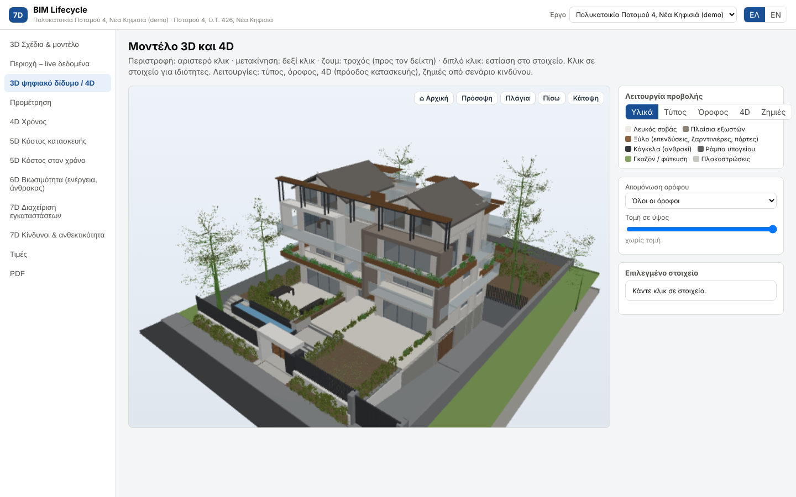

---

## Με λίγα λόγια

Η εφαρμογή είναι ένα **ψηφιακό δίδυμο** της πολυκατοικίας: ένα τρισδιάστατο μοντέλο όπου κάθε στοιχείο
(κολόνα, δοκός, πλάκα, τοίχος, κούφωμα) «ξέρει» τι υλικό είναι, πόσο κοστίζει, πόσο ζει και πότε θέλει συντήρηση.
Πάνω σε αυτό το μοντέλο απαντά σε ερωτήματα που ενδιαφέρουν τον ιδιοκτήτη, τον διαχειριστή ή τον δημόσιο φορέα
**για όλη τη ζωή του κτιρίου**, όχι μόνο για την κατασκευή:

| Ερώτημα | Πού απαντά |
|---|---|
| Πόσο κοστίζει να χτιστεί και πόσο διαρκεί η κατασκευή; | 4D Χρόνος, 5D Κόστος κατασκευής |
| Πόσο θα κοστίσει στα επόμενα 50 χρόνια (συντήρηση, αντικαταστάσεις, ενέργεια); | 5D Κόστος στον χρόνο |
| Πόση ενέργεια καταναλώνει και ποιο είναι το περιβαλλοντικό του αποτύπωμα; | 6D Ενέργεια & βιωσιμότητα |
| Πόσα πληρώνει κάθε ιδιοκτησία για τη λειτουργία του κτιρίου; | 7D Διαχείριση εγκαταστάσεων |
| Πόσο αντέχει σε σεισμό, φωτιά, πλημμύρα και τι ζημιά να περιμένουμε; | 7D Κίνδυνοι & ανθεκτικότητα |
| Τι λένε τα πραγματικά δεδομένα της περιοχής και της αγοράς σήμερα; | Περιοχή – live δεδομένα, Τιμές |

Όλα τα αποτελέσματα εξάγονται σε **PDF πλήρους μελέτης**, στα Ελληνικά ή στα Αγγλικά.

## Κίνητρο

Η εφαρμογή αναπτύχθηκε ως **διπλωματική εργασία** με τίτλο «Ανάπτυξη μοντέλου 7D-BIM και ανάλυση κύκλου ζωής κτιριακού έργου».
Στόχος είναι να δείξει πώς ένα μοντέλο BIM μπορεί να συνοδεύει ένα κτίριο σε όλη του τη ζωή —από τη μελέτη και την κατασκευή
ως τη χρήση, τη συντήρηση και την αντιμετώπιση κινδύνων— και να δίνει στον ιδιοκτήτη, στον διαχειριστή ή στον δημόσιο φορέα
τεκμηριωμένες απαντήσεις για κόστος, ενέργεια και ασφάλεια. Ως έργο εφαρμογής χρησιμοποιήθηκε πραγματική πολυκατοικία κατοικιών στη Νέα Κηφισιά,
με τα σχέδια της οικοδομικής άδειας, τη στατική μελέτη και το τρισδιάστατο μοντέλο της.

## Οι «διαστάσεις» του BIM

| Διάσταση | Τι σημαίνει | Τι κάνει η εφαρμογή |
|---|---|---|
| **3D** | Γεωμετρία | Μοντέλο από τα σχέδια της άδειας, το Rhino και τους ξυλοτύπους της στατικής μελέτης |
| **4D** | Χρόνος | Χρονοπρόγραμμα κατασκευής (Gantt, κρίσιμη διαδρομή) και διάρκεια ζωής κάθε στοιχείου |
| **5D** | Κόστος | Προϋπολογισμός με τρέχουσες τιμές αγοράς και κόστος κύκλου ζωής (EN 15459) |
| **6D** | Βιωσιμότητα | Ενεργειακή κλάση (ΚΕΝΑΚ), μέτρα αναβάθμισης, ανθρακικό αποτύπωμα (EN 15978) |
| **7D** | Διαχείριση εγκαταστάσεων & περιουσιακών στοιχείων | Ιδιοκτησίες και επιμερισμός δαπανών, μητρώο εγκαταστάσεων, συντήρηση· διαχείριση κινδύνων (σεισμός, φωτιά, πλημμύρα, αναμενόμενη ετήσια ζημιά, ανθεκτικότητα) |

Μετά την τρίτη διάσταση δεν υπάρχει ενιαίος ορισμός. Η εφαρμογή ακολουθεί την πλειονότητα των επαγγελματιών στην έρευνα των
Charef κ.ά. (2018): 6D = βιωσιμότητα, 7D = διαχείριση εγκαταστάσεων. Οι κίνδυνοι κατά τη λειτουργία ανήκουν στο 7D ως διαχείριση
κινδύνων των περιουσιακών στοιχείων (ISO 55000, ISO 31000).

## Βασικά αποτελέσματα για το κτίριο της Κηφισιάς

| | |
|---|---|
| Κόστος κατασκευής | **≈ 1,59 εκ. €** |
| Διάρκεια κατασκευής | **47 εβδομάδες** |
| Κόστος κύκλου ζωής 50 ετών (παρούσα αξία) | **≈ 2,57 εκ. €**, δηλαδή ≈ 100.000 € τον χρόνο |
| Ενεργειακή κλάση | **Α+** (26 kWh/m² πρωτογενής ενέργεια, έναντι 92 του κτιρίου αναφοράς) |
| Σεισμική αντοχή (από τον πραγματικό οπλισμό) | πρώτη διαρροή στα **0,17 g**, εξάντληση στα **0,33 g**, δηλαδή **1,4 φορές** ο σεισμός σχεδιασμού (0,24 g) |
| Σεισμική επικινδυνότητα της θέσης από 933 ιστορικούς σεισμούς (1900–σήμερα) | σεισμός 475 ετών **0,22 g**, σε συμφωνία με τον αντισεισμικό κανονισμό (0,24 g) |
| Κλίμα της θέσης 1996–2025 | αύξηση θερμοκρασίας **≈ 0,3 °C ανά δεκαετία** |

*Οι τιμές αλλάζουν όταν ανανεώνονται τα live δεδομένα ή οι παραδοχές μέσα στην εφαρμογή.*

## Live δεδομένα

Η εφαρμογή δεν βασίζεται μόνο σε σταθερές παραδοχές. Όταν ανοίγει, φέρνει αυτόματα δεδομένα από δημόσιες υπηρεσίες:

- **Κτηματολόγιο:** το γεωτεμάχιο του έργου (ΚΑΕΚ, εμβαδόν, όρια, δήμος).
- **Σεισμοί:** όλοι οι σεισμοί άνω των 4 Ρίχτερ σε ακτίνα 150 km από το 1900 (USGS). Από αυτούς υπολογίζεται
  πόσο συχνά αναμένεται κάθε ένταση σεισμού στη θέση του κτιρίου.
- **Κλίμα:** ο καιρός των τελευταίων 30 ετών (Open-Meteo / ERA5): βαθμοημέρες θέρμανσης και ψύξης, καύσωνες, τάσεις.
- **Τιμές υλικών:** χάλυβας, αλουμίνιο, χαλκός, πετρέλαιο (χρηματιστηριακές τιμές) και δείκτης κόστους κατασκευής της Eurostat.
  Από το ιστορικό 10 ετών εκτιμάται πώς θα κινηθούν οι τιμές στο μέλλον.

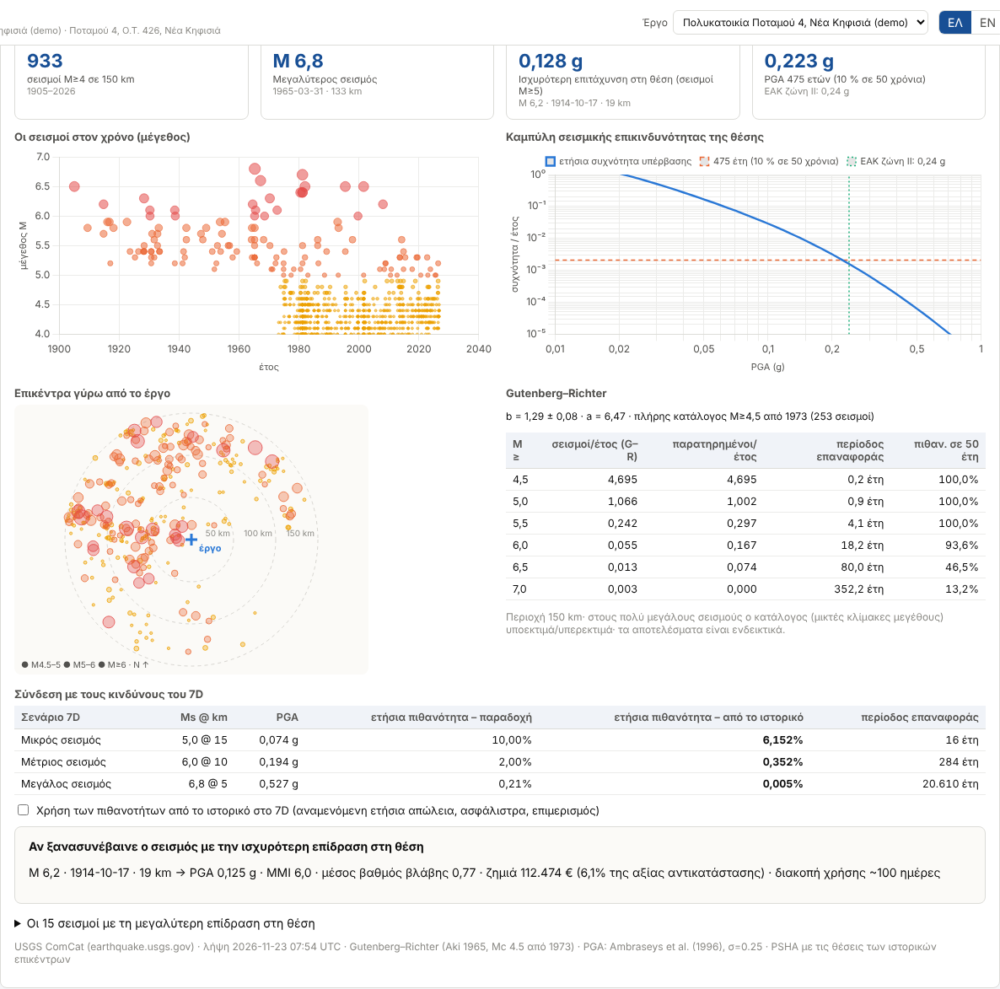

## Σεισμική αντοχή από τον πραγματικό οπλισμό

Ο φέρων οργανισμός (υποστυλώματα, δοκοί, τοιχώματα) διαβάστηκε από τους **ξυλοτύπους της στατικής μελέτης**
(Σ.01–Σ.06) με τις πραγματικές διατομές και τον οπλισμό τους. Η αντοχή στον σεισμό υπολογίζεται από τα σίδερα κάθε στοιχείου:
καμπτική και διατμητική αντοχή, έλεγχος κόμβων (ισχυρά υποστυλώματα – ασθενείς δοκοί) και μηχανισμός ορόφου.
Τα αποτελέσματα τροφοδοτούν τα σενάρια ζημιάς και την αναμενόμενη ετήσια ζημιά του 7D.

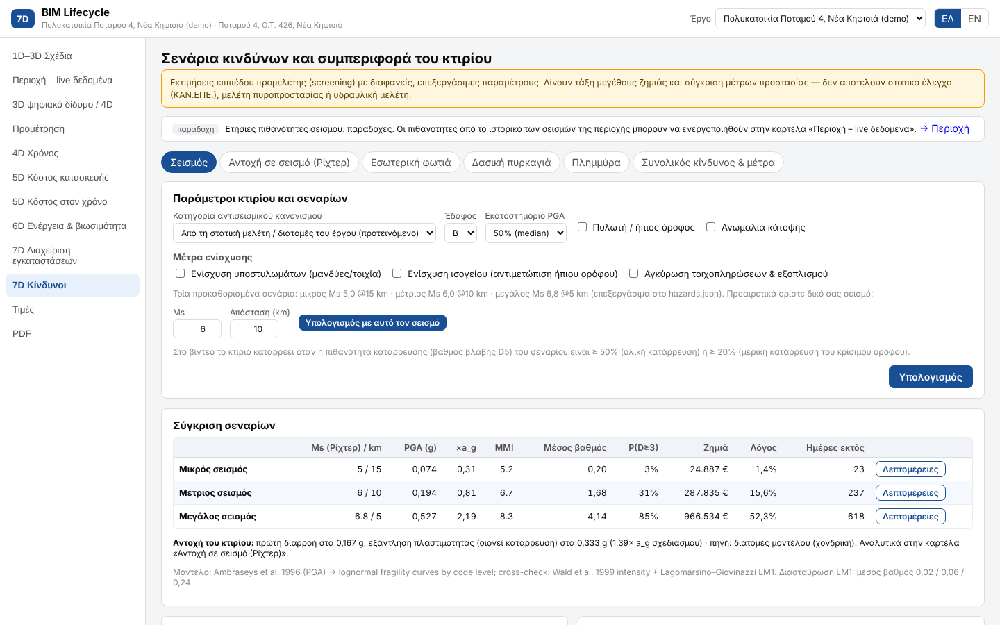

## Εικόνες από την εφαρμογή

| | |
|---|---|
| **Κόστος κύκλου ζωής (5D)** 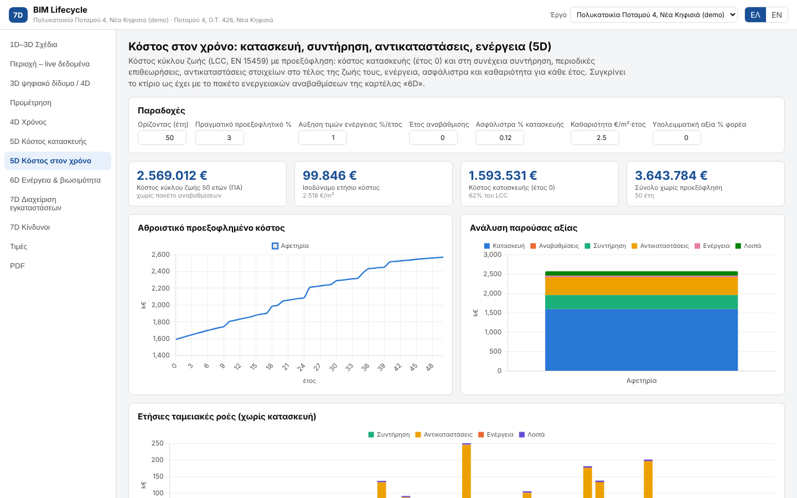 | **Ενέργεια & βιωσιμότητα (6D)** 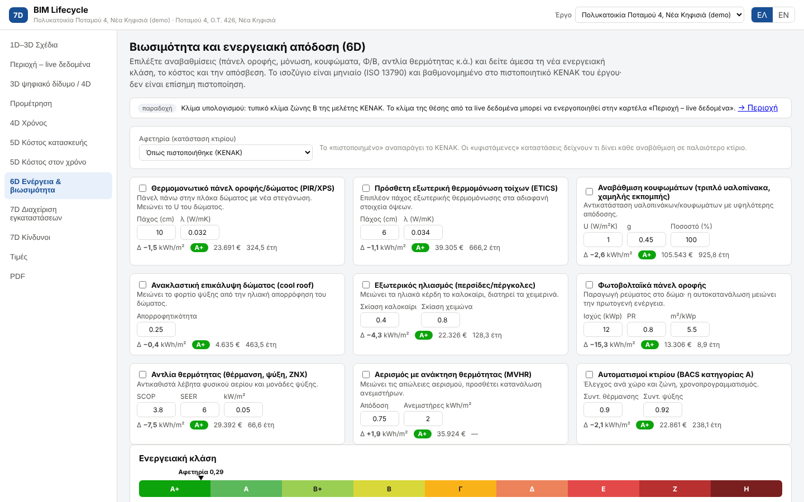 |
| **Διαχείριση εγκαταστάσεων (7D)** 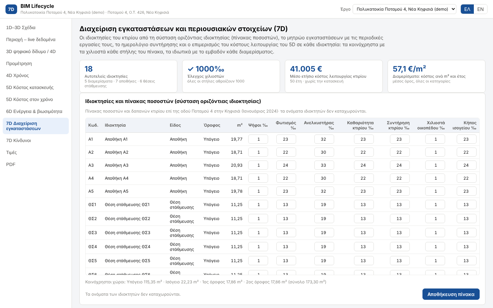 | **Κόστος κατασκευής (5D)** 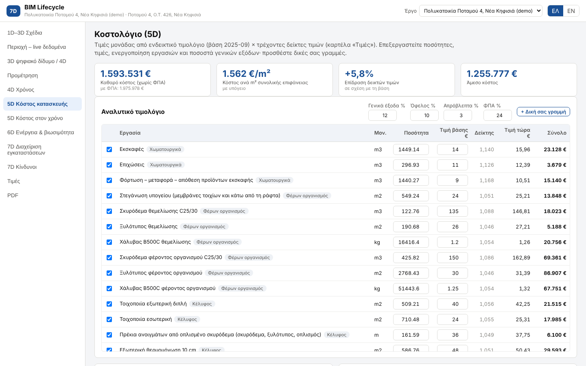 |
| **Χρονοπρόγραμμα (4D)** 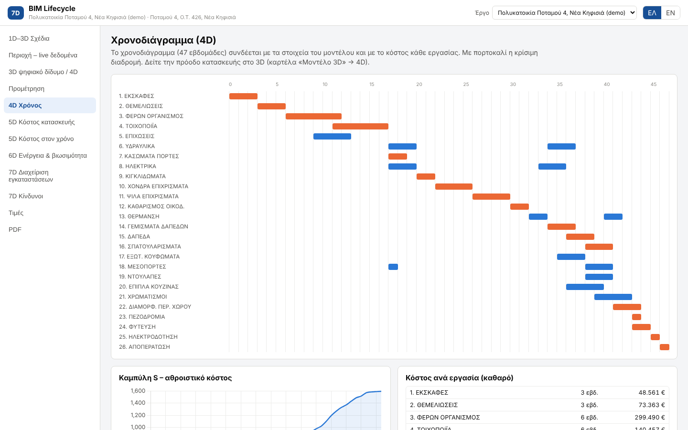 | **Κλίμα της θέσης** 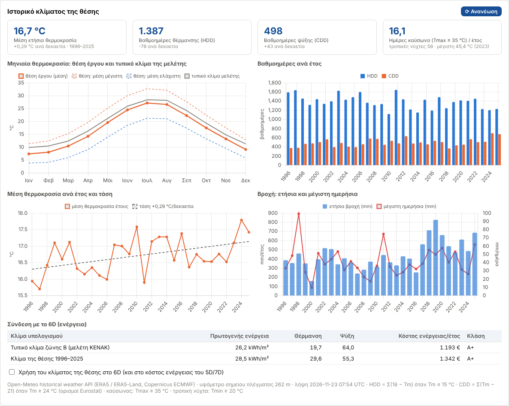 |
| **Τιμές υλικών** 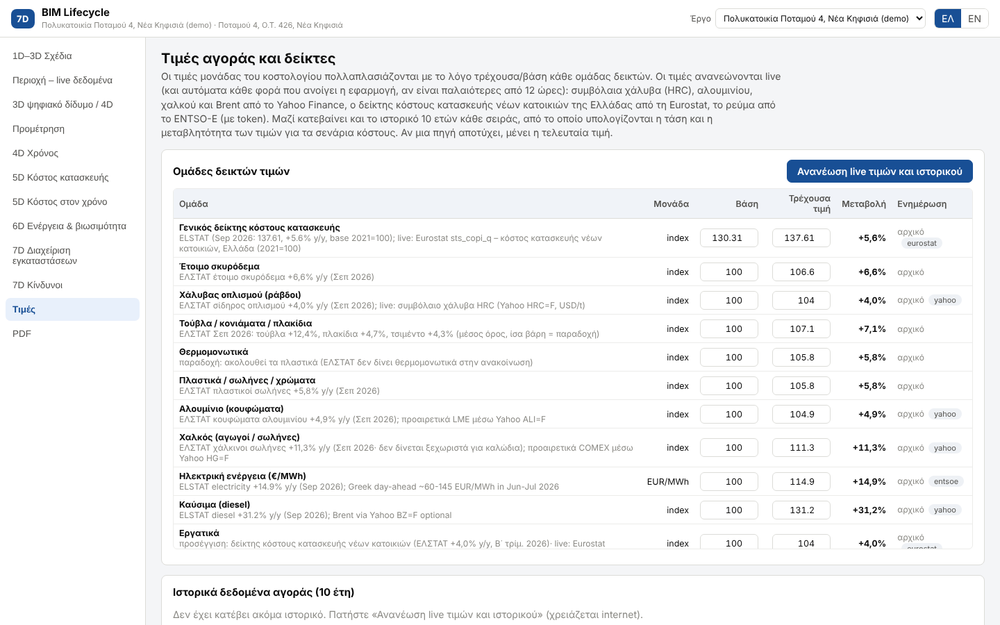 | **Προμέτρηση** 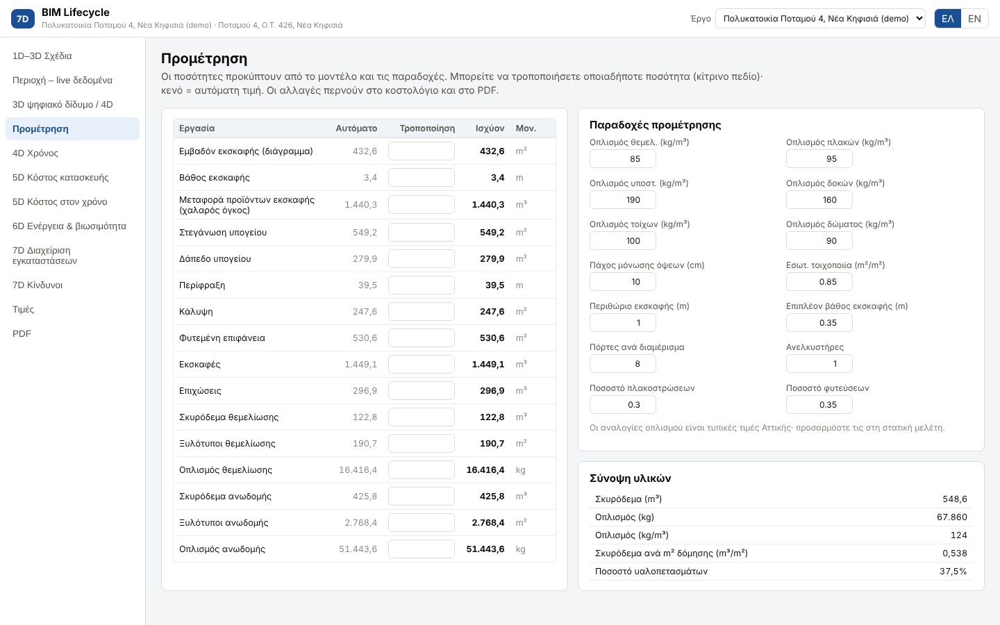 |

## Περιορισμοί

- Οι εκτιμήσεις κινδύνων είναι **επιπέδου προμελέτης** (screening): δίνουν τάξη μεγέθους και σύγκριση μέτρων.
  Δεν αντικαθιστούν στατικό έλεγχο (ΚΑΝ.ΕΠΕ.), μελέτη πυροπροστασίας ή υδραυλική μελέτη.
- Η κίνηση στα βίντεο ζημιών είναι σχηματική. Οι τιμές ζημιάς προκύπτουν από τα μοντέλα της καρτέλας «Κίνδυνοι».
- Τα live δεδομένα εξαρτώνται από τη διαθεσιμότητα των δημόσιων υπηρεσιών. Χωρίς σύνδεση χρησιμοποιείται η τελευταία λήψη.
- Δεν καταχωρούνται ονόματα ιδιοκτητών.

---

## Για τεχνικούς

### Εκτέλεση στον υπολογιστή

1. Εγκατάσταση Python 3.11+ από python.org (με «Add python.exe to PATH»).
2. Windows: διπλό κλικ στο **`start.bat`**. Linux/macOS: `./start.sh`.
3. Ανοίγει ο browser στο `http://127.0.0.1:8000`.

### Εκτέλεση με Docker

Με εγκατεστημένο το [Docker Desktop](https://www.docker.com/products/docker-desktop/), από τον φάκελο του repository:

```
docker compose up --build
```

και άνοιγμα του `http://localhost:8000`. Είναι η ίδια εικόνα (image) που τρέχει και η online έκδοση, οπότε τα αποτελέσματα
είναι ίδια σε κάθε υπολογιστή. Τα δεδομένα του έργου διατηρούνται στον τόμο `bim7d-projects` μεταξύ επανεκκινήσεων.

### Online εγκατάσταση (Render)

Το repository περιέχει `Dockerfile` και `render.yaml`. Στο Render: **New → Blueprint → επιλογή αυτού του repository**,
**Apply**. Προαιρετικά, με τη μεταβλητή `BIM7D_ACCESS_PASSWORD` η εφαρμογή ζητά κωδικό. Κάθε νέα αλλαγή στο GitHub ενημερώνει αυτόματα την εφαρμογή.

### Τεχνολογίες

Python (FastAPI, NumPy, SciPy, Shapely, trimesh, PyMuPDF, matplotlib, ReportLab) για τους υπολογισμούς,
three.js για το 3D και Chart.js για τα διαγράμματα. Τεστ: `pip install -r requirements-dev.txt && pytest`.

### Δομή

| Φάκελος | Περιεχόμενο |
|---|---|
| `app/` | Υπολογισμοί και API (κόστος, χρόνος, ενέργεια, κίνδυνοι, live δεδομένα, PDF) |
| `app/data/` | Δεδομένα του έργου: τιμολόγιο, υλικά, σκελετός από τη στατική μελέτη, ιδιοκτησίες |
| `web/` | Περιβάλλον χρήστη |
| `tools/` | Σενάρια εξαγωγής δεδομένων (ξυλότυποι στατικής μελέτης, 3D από Rhino) |
| `tests/` | Αυτόματοι έλεγχοι με καταγεγραμμένα πραγματικά δεδομένα |
| `docs/MANUAL.md` | Αναλυτικό εγχειρίδιο και μεθοδολογία |

## Άδεια

Copyright © 2026 Οδυσσέας Μπαρούτης.

Το λογισμικό διατίθεται με την άδεια **GNU General Public License v3.0** (βλ. [`LICENSE`](LICENSE)).
Μπορείτε να το χρησιμοποιήσετε, να το μελετήσετε, να το τροποποιήσετε και να το διανείμετε,
με την προϋπόθεση ότι κάθε παράγωγο έργο διατίθεται επίσης ανοιχτό με την ίδια άδεια.
Οι άδειες των βιβλιοθηκών τρίτων αναφέρονται στο [`THIRD_PARTY.md`](THIRD_PARTY.md).

```
7D-BIM Lifecycle Tool
Copyright (C) 2026 Odysseas Baroutis

This program is free software: you can redistribute it and/or modify
it under the terms of the GNU General Public License as published by
the Free Software Foundation, either version 3 of the License, or
(at your option) any later version.

This program is distributed in the hope that it will be useful,
but WITHOUT ANY WARRANTY; without even the implied warranty of
MERCHANTABILITY or FITNESS FOR A PARTICULAR PURPOSE.  See the
GNU General Public License for more details.

You should have received a copy of the GNU General Public License
along with this program.  If not, see <https://www.gnu.org/licenses/>.
```

Τα δεδομένα του έργου της Κηφισιάς (στοιχεία από τα σχέδια, τη στατική μελέτη και τον πίνακα ποσοστών) δημοσιεύονται με την έγκριση
του τεχνικού γραφείου, ως παράδειγμα εφαρμογής της διπλωματικής εργασίας. Δεν περιλαμβάνονται προσωπικά δεδομένα (ονόματα ιδιοκτητών).
